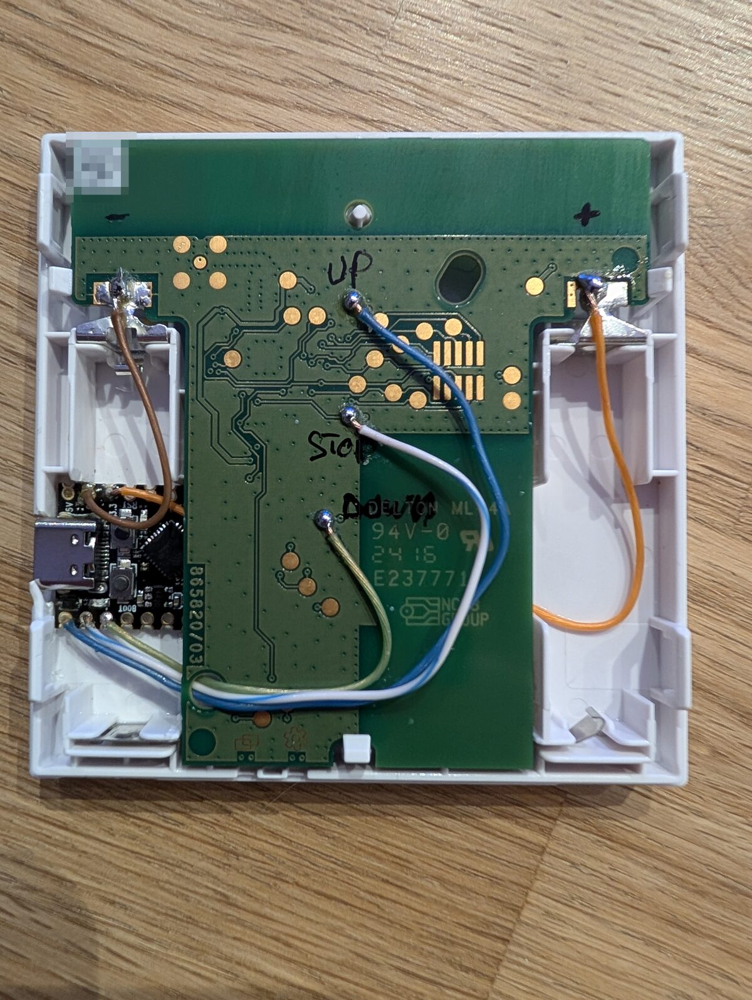

# ESP32-C3 → Velux (io-homecontrol) pour Home Assistant / Alexa

🇬🇧 [English version](README.md)

Un ESP32-C3 sous [ESPHome](https://esphome.io) « appuie » sur les boutons
▲ ■ ▼ d'une télécommande Velux **3LI D13 WW** dédiée. La télécommande
s'occupe de la radio io-homecontrol (chiffrée) : pas besoin de passerelle
KLF 200.

<p align="center"></p>

*L'ESP32-C3 Super Mini tient dans le boîtier de la télécommande (en bas à gauche).*

- **Aucun composant** : la télécommande est alimentée par le 3V3 de
  l'ESP32 et chaque GPIO est soudé directement sur un bouton.
- **Bidirectionnel** : en open-drain, le GPIO tire la ligne à 0 V pour
  appuyer, et le reste du temps il la **relit**. Un appui fait à la main sur
  la télécommande met aussi à jour l'état du volet dans Home Assistant.
- **Plusieurs Velux** : si la télécommande pilote un groupe (ici 5 Velux),
  ils bougent ensemble et sont exposés comme un seul volet.

Même idée que
[thorio/velux-controller](https://github.com/thorio/esphome-projects/tree/master/velux-controller),
sans carte dédiée.

## Matériel
| Qté | Pièce |
|---|---|
| 1 | ESP32-C3 Super Mini (`esp32-c3-devkitm-1`) |
| 1 | Télécommande 3LI D13 WW supplémentaire (sans ses 2 piles AAA) |
| *(option)* | Condensateurs 100 µF (≥ 6,3 V) + 100 nF, seulement en cas d'appuis ratés |
| 5 | Fils fins (AWG 28–30) |

## 1. Jumeler la 2ᵉ télécommande
Suivre la procédure Velux « copier une télécommande io-homecontrol »
(touches RESET au dos de l'ancienne puis de la nouvelle, voir la notice).
Vérifier que la nouvelle télécommande pilote bien **tous** les Velux
avant de la démonter.

## 2. Repérer les pastilles
1. **Continuité** (piles retirées) : sur chaque bouton, une pastille bipe avec
   le − du compartiment → c'est le **GND**. L'autre est le **signal**.
2. **Tension** (piles remises) : pointe noire au −, pointe rouge sur chaque
   signal → **≈ 3 V** au repos, **0 V** en appuyant, et toujours ≈ 3 V après
   10–20 s de veille. *(Validé sur la 3LI D13 WW : 3 V partout, même en veille.)*
3. Court-circuiter signal et GND avec un fil → les Velux doivent bouger.

Si un bouton n'a aucune pastille reliée au GND, il est câblé en matrice : ce
montage direct ne marche pas, il faut alors des optocoupleurs.

## 3. Câblage
Schéma détaillé : [`docs/cablage.html`](docs/cablage.html) (à ouvrir dans un
navigateur).

```
  ESP32-C3 Super Mini               Télécommande 3LI D13 WW (sans piles)
  3V3 ────────────┬──────────────── borne + du compartiment (extrémité)
                  │
        100 µF + 100 nF   (optionnels, au plus près de la télécommande)
                  │
  GND ────────────┴──────────────── borne − du compartiment (autre extrémité)
  GPIO5 ─────────────────────────── pastille signal ▲
  GPIO6 ─────────────────────────── pastille signal ■
  GPIO7 ─────────────────────────── pastille signal ▼
```

- **Retirer les 2 piles AAA** : branchées sur le 3,3 V elles recevraient du
  courant de charge et fuiraient.
- Souder sur les **deux extrémités** du compartiment, pas sur la lamelle du
  milieu qui relie les piles entre elles.
- **Pas de diode** entre le 3V3 et la télécommande : elle doit être au même
  potentiel que les GPIO, sinon l'ESP32 l'alimenterait par ses boutons.
- **Condensateurs optionnels** : le montage en photo fonctionne sans. Ils
  absorbent le bruit du Wi-Fi et les pics d'émission radio : à ajouter si des
  appuis sont ratés.
- Sur le C3, éviter les broches de démarrage (2, 8, 9) et l'USB/UART (18–21).
  GPIO5/6/7 sont des GPIO normaux, côte à côte sur la Super Mini.

## 4. Flasher
```bash
python3 -m venv .venv && .venv/bin/pip install esphome
cd esphome
cp secrets.yaml.example secrets.yaml && $EDITOR secrets.yaml
../.venv/bin/esphome run velux.yaml   # 1er flash en USB, ensuite OTA (Wi-Fi)
```
Ou coller `velux.yaml` dans l'add-on ESPHome de Home Assistant.

Dans `velux.yaml`, régler `address` (section `substitutions`) sur le nom ou
l'IP de l'ESP sur ton réseau. `velux.local` (mDNS) ne fonctionne que si le PC
et l'ESP sont sur le même sous-réseau. Sinon, utiliser un nom DNS du routeur
(ex. `velux.lan`) ou une IP fixe.

> Un ESP32-C3 neuf a une flash vide : il redémarre en boucle
> (`invalid header: 0xffffffff`) et se déconnecte de l'USB toutes les ~2 s.
> C'est normal, le premier flash règle ça. Si la connexion échoue, maintenir
> BOOT en le branchant.

## 5. Tester avant de souder côté télécommande
Au multimètre (tension continue, pointe noire sur GND) :
1. Pointe rouge sur GPIO5 → **≈ 3,3 V** au repos (pull-up interne).
2. « Bouton haut » dans Home Assistant → **0 V** pendant l'appui. Pour avoir
   le temps de lire, passer temporairement `pulse_ms` à `3s`.
3. Même chose pour GPIO6 (« Bouton stop ») et GPIO7 (« Bouton bas ») ; les
   autres boutons ne doivent pas faire bouger la broche testée.
4. Toucher chaque fil avec un fil relié au GND → le capteur « Appui manuel »
   correspondant s'allume dans HA.

Remettre `pulse_ms: 300ms` avant de souder.

## 6. Calibrer
Chronométrer fermé → ouvert et ouvert → fermé (en incluant le ~1 s de délai
entre l'appui et le démarrage), ajouter ~1 s de marge, reporter dans
`open_duration` / `close_duration`, reflasher.

- **Groupe de Velux** : chronométrer le **plus lent**. Les moteurs s'arrêtent
  seuls en fin de course (`has_built_in_endstop`), les plus rapides ont
  simplement fini avant.
- La position est **estimée au temps**. Ouvrir/fermer sont fiables. Les
  positions intermédiaires (ex. 50 %) sont approximatives, surtout pour un
  groupe de Velux de tailles différentes : ils s'arrêtent tous au même instant.
- Les appuis faits à la main sur la télécommande pilotée sont relus. Ceux faits
  avec une **autre** télécommande ou au clavier mural ne sont pas vus : l'état
  se recale au prochain ouvrir/fermer complet.

## 7. Home Assistant
Paramètres → Appareils et services → Ajouter une intégration → ESPHome →
hôte = `address`, clé de chiffrement = `api_key` de `secrets.yaml`.

Entités créées (préfixe selon le nom donné à l'appareil dans HA) :
| Entité | Rôle |
|---|---|
| `cover.velux` | le volet à utiliser |
| `button.velux_bouton_haut/stop/bas` | appuis bruts, pour test/recalage |
| `binary_sensor.velux_appui_manuel_haut/stop/bas` | s'allument quand on appuie à la main sur la télécommande |
| `sensor.velux_signal_wi_fi`, `_temperature_interne`, `_uptime` | diagnostic |

## 8. Alexa (skill manuel)
Dans `configuration.yaml`, ajouter à la config `alexa:` existante :
```yaml
alexa:
  smart_home:
    filter:
      include_entities:
        - cover.velux          # garder les entités déjà incluses
    entity_config:
      cover.velux:
        name: "Velux"
        display_categories: EXTERIOR_BLIND
```
Redémarrer HA → app Alexa → « Découvrir les appareils ».
« Alexa, ouvre les Velux » / « Alexa, ferme les Velux » /
« Alexa, mets les Velux à 50 % ».

## Dépannage
| Symptôme | Cause / solution |
|---|---|
| Appuis manuels fantômes, ~1,5 V sur un GPIO au repos | ligne qui flotte : vérifier que `pullup: true` est bien présent, et la soudure |
| Appui raté de temps en temps | `pulse_ms: 500ms`, ou ajouter les condensateurs (100–470 µF + 100 nF) |
| `Authentication Failed` dans les logs Wi-Fi | mot de passe faux, ou firmware pas recompilé : utiliser `esphome run` (pas `upload` seul) après avoir modifié `secrets.yaml` |
| OTA impossible vers `velux.local` | PC et ESP sur des sous-réseaux différents : mettre un nom DNS ou une IP dans `address` |
| Température interne 30–45 °C | normal (température de la puce, Wi-Fi actif) |

## Licence
[MIT](LICENSE)
