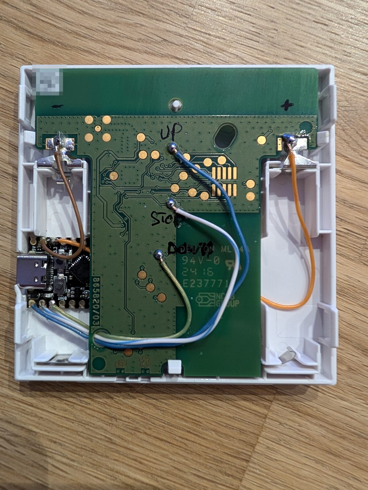

# ESP32-C3 → Velux (io-homecontrol) for Home Assistant / Alexa

🇫🇷 [Cette documentation existe en français](README.fr.md)

An ESP32-C3 running [ESPHome](https://esphome.io) "presses" the ▲ ■ ▼
buttons of a dedicated Velux **3LI D13 WW** remote. The remote handles the
(encrypted) io-homecontrol radio, so no KLF 200 gateway is needed.

<p align="center"></p>

*The ESP32-C3 Super Mini fits inside the remote's housing (bottom left).*

- **No extra components**: the remote is powered from the ESP32's 3V3 rail
  and each GPIO is soldered straight onto a button.
- **Two-way**: in open-drain mode, the GPIO pulls the line to 0 V to press,
  and **reads it back** the rest of the time. Pressing the remote by hand
  also updates the cover state in Home Assistant.
- **Several Velux windows**: if the remote controls a group (5 windows here),
  they move together and show up as a single cover.

Same idea as
[thorio/velux-controller](https://github.com/thorio/esphome-projects/tree/master/velux-controller),
without a custom board.

## Hardware
| Qty | Part |
|---|---|
| 1 | ESP32-C3 Super Mini (`esp32-c3-devkitm-1`) |
| 1 | Spare 3LI D13 WW remote (without its 2 AAA batteries) |
| *(optional)* | 100 µF (≥ 6.3 V) + 100 nF capacitors, only if presses get missed |
| 5 | Thin wires (AWG 28–30) |

## 1. Pair the second remote
Follow the Velux "copy an io-homecontrol remote" procedure (RESET buttons on
the back of the old remote, then the new one; see the manual). Check that the
new remote controls **all** your windows before taking it apart.

## 2. Find the pads
1. **Continuity** (batteries out): on each button, one pad beeps with the
   battery − terminal → that's **GND**. The other one is the **signal**.
2. **Voltage** (batteries in): black probe on −, red probe on each signal pad
   → **≈ 3 V** at rest, **0 V** while pressed, and still ≈ 3 V after 10–20 s
   of sleep. *(Confirmed on the 3LI D13 WW: 3 V everywhere, even asleep.)*
3. Short signal to GND with a wire → the windows should move.

If a button has no pad connected to GND, it's wired as a matrix: this direct
wiring won't work and you'll need optocouplers instead.

## 3. Wiring
Detailed diagram: **[view online](https://nyrrell.github.io/velux-esp32-remote/cablage.html)**
(source: [`docs/cablage.html`](docs/cablage.html)).

```
  ESP32-C3 Super Mini               3LI D13 WW remote (no batteries)
  3V3 ────────────┬──────────────── battery + terminal (one end)
                  │
        100 µF + 100 nF   (optional, as close to the remote as possible)
                  │
  GND ────────────┴──────────────── battery − terminal (other end)
  GPIO5 ─────────────────────────── ▲ signal pad
  GPIO6 ─────────────────────────── ■ signal pad
  GPIO7 ─────────────────────────── ▼ signal pad
```

- **Remove both AAA batteries**: on a 3.3 V supply they would get charged
  and leak.
- Solder to **both ends** of the battery compartment, not to the middle strip
  that links the two batteries.
- **No diode** between 3V3 and the remote: it must sit at the same potential
  as the GPIOs, otherwise the ESP32 would power it through its buttons.
- **Capacitors are optional**: the build in the photo works without them. They
  soak up Wi-Fi noise and radio transmit spikes; add them if presses get
  missed.
- On the C3, avoid the strapping pins (2, 8, 9) and USB/UART (18–21).
  GPIO5/6/7 are plain GPIOs, side by side on the Super Mini.

## 4. Flash
```bash
python3 -m venv .venv && .venv/bin/pip install esphome
cd esphome
cp secrets.yaml.example secrets.yaml && $EDITOR secrets.yaml
../.venv/bin/esphome run velux.yaml   # first flash over USB, then OTA (Wi-Fi)
```
Or paste `velux.yaml` into the Home Assistant ESPHome add-on.

In `velux.yaml`, set `address` (in `substitutions`) to the ESP's hostname or
IP on your network. `velux.local` (mDNS) only works if your PC and the ESP
are on the same subnet. Otherwise use a router DNS name (e.g. `velux.lan`) or
a fixed IP.

> A brand-new ESP32-C3 has an empty flash: it boot-loops
> (`invalid header: 0xffffffff`) and drops off USB every ~2 s. That's normal
> and the first flash fixes it. If it won't connect, hold BOOT while plugging
> it in.

## 5. Test before soldering to the remote
With a multimeter (DC voltage, black probe on GND):
1. Red probe on GPIO5 → **≈ 3.3 V** at rest (internal pull-up).
2. Press "Bouton haut" (up) in Home Assistant → **0 V** during the press.
   To have time to read it, temporarily set `pulse_ms` to `3s`.
3. Same for GPIO6 ("Bouton stop") and GPIO7 ("Bouton bas", down); the other
   buttons must not affect the pin under test.
4. Touch each wire with a wire tied to GND → the matching "Appui manuel"
   (manual press) sensor turns on in HA.

Set `pulse_ms: 300ms` back before soldering.

## 6. Calibrate
Time closed → open and open → closed (including the ~1 s delay between the
press and the motor starting), add ~1 s of margin, put the values in
`open_duration` / `close_duration`, and flash again.

- **Group of windows**: time the **slowest** one. The motors stop on their
  own at the end of travel (`has_built_in_endstop`); the faster ones simply
  finish earlier.
- The position is **estimated from time**. Open/close are reliable.
  Intermediate positions (e.g. 50 %) are approximate, especially for a group
  of windows of different sizes, since they all stop at the same moment.
- Manual presses on the wired remote are read back. Presses from **another**
  remote or the wall keypad are not seen; the state resyncs on the next full
  open/close.

## 7. Home Assistant
Settings → Devices & services → Add integration → ESPHome →
host = `address`, encryption key = `api_key` from `secrets.yaml`.

Created entities (entity names are in French; the prefix follows the device
name in HA):
| Entity | Purpose |
|---|---|
| `cover.velux` | the cover to use |
| `button.velux_bouton_haut/stop/bas` | raw up/stop/down presses, for testing/resyncing |
| `binary_sensor.velux_appui_manuel_haut/stop/bas` | turn on when the remote is pressed by hand |
| `sensor.velux_signal_wi_fi`, `_temperature_interne`, `_uptime` | diagnostics |

## 8. Alexa (manual skill)
In `configuration.yaml`, add to your existing `alexa:` config:
```yaml
alexa:
  smart_home:
    filter:
      include_entities:
        - cover.velux          # keep your already included entities
    entity_config:
      cover.velux:
        name: "Velux"
        display_categories: EXTERIOR_BLIND
```
Restart HA → Alexa app → "Discover devices".
"Alexa, open the Velux" / "Alexa, close the Velux" /
"Alexa, set the Velux to 50 %".

## Troubleshooting
| Symptom | Cause / fix |
|---|---|
| Ghost manual presses, ~1.5 V on an idle GPIO | floating line: check that `pullup: true` is set, and check the solder joint |
| Occasional missed press | `pulse_ms: 500ms`, or add the capacitors (100–470 µF + 100 nF) |
| `Authentication Failed` in Wi-Fi logs | wrong password, or firmware not rebuilt: use `esphome run` (not just `upload`) after editing `secrets.yaml` |
| OTA to `velux.local` fails | PC and ESP on different subnets: put a DNS name or IP in `address` |
| Internal temperature 30–45 °C | normal (chip temperature with Wi-Fi on) |

## License
[MIT](LICENSE)
